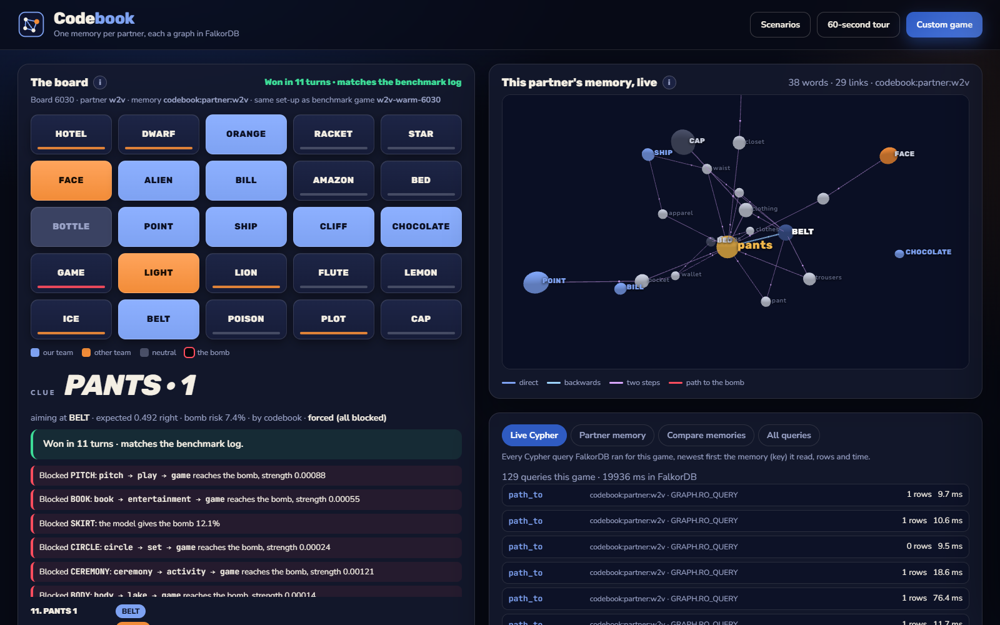
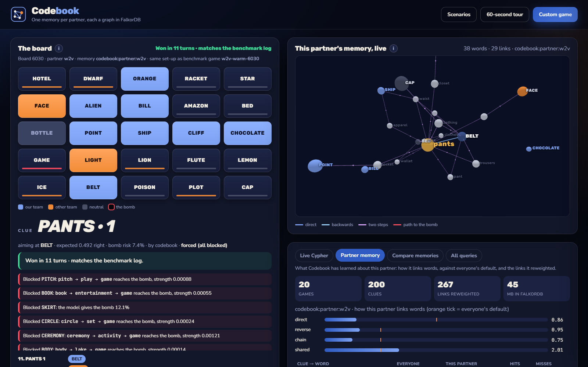
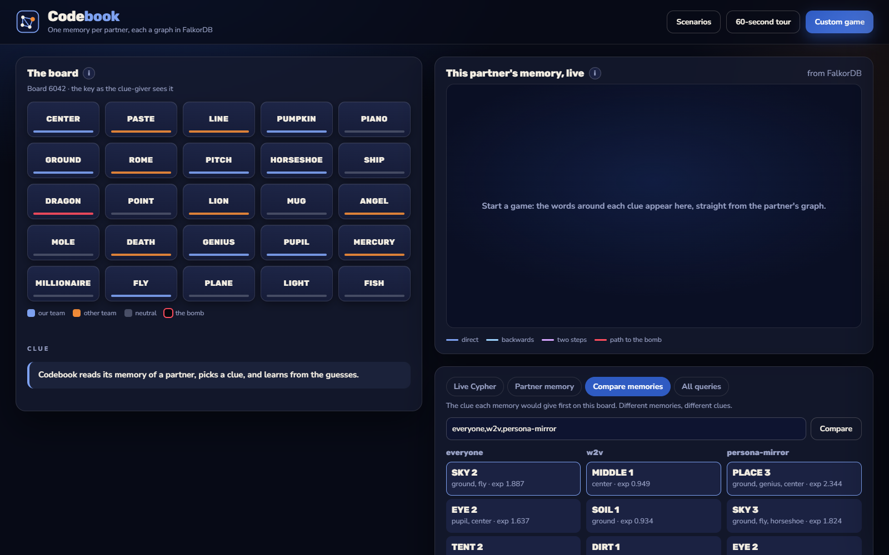

# Codebook

**An AI teammate that learns how you think, remembers it next time, and can pass that memory to another AI.**

People who play word games together build a private shorthand: after a few games you know your partner
will hear "ocean" and think *wave*, not *bank*. AI teammates forget all of that the moment a session ends.
Codebook is a Codenames clue-giver that keeps **one memory per partner in FalkorDB**. It learns from every
graded guess, keeps that memory across sessions and restarts, and hands it to any other AI (Claude, Codex,
anything that speaks MCP) through tools, never through database credentials.

Graph Hacks 2026, **Track 02: Agent Memory and Coordination**.

> Results: see [Results](#results). The evaluation was written down and committed before the first test
> run ([EVAL.md](EVAL.md)); every promise is reported, kept or not.



| What this partner's memory holds | Same board, three memories, three different clues |
|---|---|
|  |  |

---

## Why a graph, and why FalkorDB

| What Codebook needs | How FalkorDB does it |
|---|---|
| Everyone's memory: tens of thousands of words and half a million weighted links (SWOW-EN18 human associations, or ConceptNet 5.7) | one graph, `codebook:population` |
| Score a clue by every direct, reverse, two-step and shared link to each board word, every turn | Cypher traversals over the link graph (`DIRECT`, `REVERSE`, `CHAIN`, `SHARED`, `PATH_TO`) |
| A separate, persistent memory per partner that starts as a copy of everyone's | each partner is its own graph key, made with `GRAPH.COPY` (0.7 s and 44 MB at 497k links) |
| Partners must not read or write each other's memory | Redis ACL users with a selector per partner key |
| Survive restarts and hand a memory from one AI to another | it is a key on the server; any process that is allowed to open it gets the same memory |
| Carry a memory to another server | `DUMP`/`RESTORE`: one partner's memory is an 11 MB file, indexes included |

Remove FalkorDB and nothing runs: there is no in-memory fallback. With the server stopped, every
command exits with an error that names FalkorDB.

## How it works

```
                 everyone's memory                      your memory (one per partner)
             codebook:population (read-only)   GRAPH.COPY   codebook:partner:<id>
   (:Word)-[:ASSOC {p}]->(:Word)  ───────────────────────►  same links + learned weights (pp, hits, misses)
                                                            + (:Partner {style}) + diary (:Game)-[:HAS]->(:Turn)
```

Every turn:

1. **Find**: Cypher reads four kinds of link between each candidate clue and every unrevealed word,
   in the memory being used: **direct** (clue → word), **reverse** (word → clue), **chain** (clue → m → word)
   and **shared associates** (clue → m ← word: both make people think of m).
2. **Score**: a small partner model turns those links into a "pull" towards each board word
   (`style · log(1 + 100·strength) + bias[word]`). Codebook simulates the partner's picks and ranks clues by
   expected team words found minus the cost of hitting the bomb or the opponent.
3. **Block**: code has the final say. A clue is refused if, in this memory, a chain of at most two links
   reaches the bomb with strength ≥ 0.02, or the model gives the bomb ≥ 5%. This applies even when Claude or
   Codex proposes the clue.
4. **Learn** (partner memories only): every pick reweights the clue→word link in that partner's graph
   (creating it if everyone's memory lacks it); intended words the partner passed over are weakened. After each
   game the diary is consolidated into the partner's style (how much they rely on each kind of link) and
   favourite words.

**Practice games probe.** A careful clue-giver only gives clues where people's direct links are strong, and
in exactly those situations a "reverse thinker" and a "direct thinker" pick the same word, so a diary of
ordinary games can't tell them apart. During practice games Codebook adds a bonus for clues on which
one-habit hypotheses (only direct, only reverse, only chains, only shared associates) predict different picks.
With it, a planted partner that thinks in reverse links is recognised as one (learned reverse weight 4.0 vs a
default of 1.5); without it, the learner never sees the difference.

## Data model

```cypher
(:Word {text, cue, clue, pool, bias})
(:Word)-[:ASSOC {p, n, pp, hits, misses, learned}]->(:Word)
(:Partner {id, direct, reverse, chain, shared, games, turns, updated})  // partner keys only
(:Game {id, seed, condition, by, turns, won})-[:HAS]->(:Turn {n, clue, count, board, feats, by, ev})
(:Turn)-[:INTENDED]->(:Word)   (:Turn)-[:GUESSED {order, outcome}]->(:Word)   (:Turn)-[:BY]->(:Agent {id})
(:Source {dataset, version, sha256, loaded_at, words, links, min_count})
CREATE INDEX FOR (w:Word) ON (w.text)
```

- `p`: share of people who gave this response to the cue (SWOW R123 strength; with ConceptNet, the edge's
  share of the cue's weight); `n`: how many.
- `pp`: this partner's weight for the link; absent in everyone's memory; written only by learning.
- Keys: `codebook:population` (never written after setup) and `codebook:partner:<id>` (the only keys written).

## The Cypher

Every statement lives in [`src/codebook/cypher.py`](src/codebook/cypher.py), and the live view shows each
one as it runs, with its key, row count and time. The core ones:

```cypher
// Find: clue words with a link into each board word (bind the indexed word first, then traverse)
UNWIND $board AS bw
MATCH (t:Word) WHERE t.text = bw
WITH t, bw
MATCH (c:Word)-[r:ASSOC]->(t)
WHERE c.clue AND coalesce(r.pp, r.p) > 0
RETURN c.text AS clue, bw AS word, coalesce(r.pp, r.p) AS s

// Shared associates: clue -> m <- word, summed over m
UNWIND $board AS bw
MATCH (t:Word) WHERE t.text = bw
WITH t, bw
MATCH (t)-[r2:ASSOC]->(m:Word)<-[r1:ASSOC]-(c:Word)
WHERE c.text IN $clues AND c <> t AND m <> c
WITH c.text AS clue, bw AS word, sum(coalesce(r1.pp, r1.p) * coalesce(r2.pp, r2.p)) AS s
WHERE s >= $floor
RETURN clue, word, s

// Two-step chains from each shortlisted clue to every board word
UNWIND $clues AS cw
MATCH (c:Word) WHERE c.text = cw
WITH c, cw
MATCH (c)-[r1:ASSOC]->(m:Word)-[r2:ASSOC]->(t:Word)
WHERE t.text IN $board AND m <> t AND t <> c
WITH cw, t.text AS word, max(coalesce(r1.pp, r1.p) * coalesce(r2.pp, r2.p)) AS s
WHERE s >= $floor
RETURN cw AS clue, word, s

// Block: the strongest chain of at most two links from the clue to the bomb, in this memory
MATCH p=(c:Word {text: $clue})-[:ASSOC*1..2]->(a:Word {text: $target})
RETURN [n IN nodes(p) | n.text] AS path,
       reduce(s = 1.0, r IN relationships(p) | s * coalesce(r.pp, r.p)) AS strength
ORDER BY strength DESC LIMIT 1

// Learn: the partner picked WORD for CLUE
UNWIND $hits AS h
MATCH (c:Word {text: h[0]}), (g:Word {text: h[1]})
MERGE (c)-[r:ASSOC]->(g)
ON CREATE SET r.p = 0.0, r.n = 0, r.learned = true
SET r.hits = coalesce(r.hits, 0) + 1
SET r.pp = (r.p + $gain * r.hits) * pow($decay, coalesce(r.misses, 0))
```

### What we learned about FalkorDB 6.0.2 while building this

1. **Index-first under `UNWIND`.** Written the obvious way (`UNWIND $board AS bw MATCH (c)-[r]->(:Word {text: bw})`),
   the planner scans every link for each board word instead of using the `Word.text` index. Binding the indexed
   node first and passing it through `WITH` gives a `Node By Index Scan` and a traversal from it: on a 497k-link
   graph, direct links went from 3.1 s to 13 ms and two-step chains from 17.6 s to 117 ms, with identical rows
   (checked with `GRAPH.EXPLAIN` and a row-by-row comparison).
2. **`OPTIONAL MATCH` after an aggregating `WITH`.** `MATCH (c) OPTIONAL MATCH (c)-[f]->(a) WITH c, collect(..)
   OPTIONAL MATCH (c)<-[b]-(t) RETURN ..` returned no rows from the second match, silently. It was the one-clue
   reader, so a planted test partner never saw a reverse link. We rewrote it as `UNION ALL` of two plain
   patterns, and a contract test now checks it against the whole-board reader (1,000 of 1,000 agree).
3. **ACL and read-only graph queries.** `GRAPH.RO_QUERY` is declared as read-write key access, so Redis's
   read-only key pattern (`%R~`) can't grant "read everyone's memory". A selector, `(~key +graph.ro_query)`, can.
4. **Graphs travel with `DUMP`/`RESTORE`** (Redis `COPY` refuses module keys): an 11 MB dump of a 497k-link
   graph restores in 0.4 s with its indexes. `codebook export`/`import` use this to carry a memory between servers.
5. **Keep same-named graphs apart across Redis databases.** Re-creating a graph in one database while a write
   ran on a same-named graph in another aborted the write ("graph was deleted or replaced"). Tests now use
   their own key prefix (`cbtest:`).

## Locks: one database user per partner

```
ACL SETUSER cb-<partner> reset on ><password> resetkeys ~codebook:partner:<partner>
    +ping +select +graph.query +graph.ro_query (~codebook:population +graph.ro_query)
```

FalkorDB declares even `GRAPH.RO_QUERY` as read-write key access, so Redis's read-only pattern (`%R~`) can't
express "read-only on everyone's memory". A selector can. The contract test
[`tests/contract/test_acl.py`](tests/contract/test_acl.py) checks the result: a partner's user can read
everyone's memory and read and write its own key. It gets `NOPERM` writing everyone's memory, reading another
partner's key, or running `GRAPH.LIST`.

## Try it

Needs Docker, [uv](https://docs.astral.sh/uv/) and Python 3.11 or 3.12.

```bash
git clone [repo URL] && cd codebook
docker compose up -d                          # FalkorDB 6.0.2 on 127.0.0.1:6390, data in a volume
uv sync --extra dev
uv run codebook setup --source conceptnet --vectors   # downloads ConceptNet 5.7 (498 MB) and the bots' vectors
# or, for human word associations: download SWOW-EN18.zip from https://smallworldofwords.org/en/project/research
# (it asks you to accept CC BY-NC-ND), save it as data/SWOW-EN18.zip, and run: uv run codebook setup --vectors
uv run codebook train glove --games 20        # 20 practice games build the GloVe bot's memory
uv run codebook play --partner glove          # watch one game in the terminal
uv run codebook ui                            # live view on http://127.0.0.1:7811
```

| Command | What it does |
|---|---|
| `codebook status` | everyone's memory and every partner memory on the server (games, clues, style, size) |
| `codebook train <partner>` | practice games with learning on (and probing) |
| `codebook play --partner P --memory own\|everyone\|<other>` | one seeded game, every clue, pick and block printed |
| `codebook replay --partner P` | fingerprint of frozen-memory games: run, restart FalkorDB, run again |
| `codebook export P` / `codebook import file --as Q` | carry a memory to another server (DUMP/RESTORE) |
| `codebook acl P` | a database user locked to this partner's key |
| `codebook eval` / `codebook report <run>` | the benchmark and its scorecard |
| `codebook ui` / `codebook mcp` | the live view / the MCP server for agents |

**Use it from any agent (MCP).** `claude mcp add codebook -- uv --directory <repo> run codebook mcp`
gives an agent six tools: `list_partners`, `suggest_clues`, `check_clue`, `record_turn`, `end_game`,
`partner_memory`. The agent never sees a database address or password.

## Evaluation

Written before the first test: [EVAL.md](EVAL.md). The unmodified Codenames AI Competition engine (MIT)
deals every board from a seed and keeps the score; its files are checksummed in
[`tests/unit/test_engine_unmodified.py`](tests/unit/test_engine_unmodified.py). Partners learn on training
boards (seeds 1000-1019) and are tested on boards they never saw (6000-6199), with memories frozen.

## Results

Run `final-20261017-1941-v2` (`scripts/final_run.sh`; every stage's commit is stamped in
`results/runs/<run>/plan.jsonl`; every game is in `results/runs/<run>/games.jsonl`). Everyone's memory:
**ConceptNet 5.7** (SWOW-EN18 needs a licence form; the code supports both). 200 test boards per set-up
(seeds 6000-6199) that no partner saw in training; memories frozen. Turns to finish, lower is better; a lost
game counts 25 (the engine's rule). Differences are paired by board with a 95% bootstrap interval; "better" means
the whole interval is below zero. Full report: [`results/final-20261017-1941-v2.md`](results/final-20261017-1941-v2.md).

| Partner | Everyone's memory | Your memory | Wrong memory | Yours vs everyone's | Yours vs wrong |
|---|---|---|---|---|---|
| word2vec bot (competition) | 15.55 turns, 33% bomb | **14.39, 21% bomb** | 15.31 (GloVe's) | **−1.16 [−2.23, −0.07] better** | **−0.92 [−1.72, −0.16] better** |
| GloVe bot (competition) | 15.75, 35% bomb | 15.64, 32% bomb | 15.02 (word2vec's) | −0.11 [−1.08, +0.87] | +0.63 [−0.12, +1.36] |
| Test partner A (planted: backwards links) | 6.60, 1% bomb | **5.63, 0% bomb** | 6.93 (B's) | **−0.98 [−1.28, −0.74] better** | **−1.30 [−1.87, −0.81] better** |
| Test partner B (planted: two-step chains) | 6.66, 0.5% bomb | **6.36, 0.5% bomb** | 7.19 (A's) | **−0.30 [−0.56, −0.03] better** | **−0.83 [−1.43, −0.26] better** |

What this says, plainly:

- **A partner's own memory beat everyone's memory for three of four partners.** For the word2vec bot it cut bomb
  hits from 33% to 21% and won 78% of games instead of 68%.
- **The memory is about the partner.** Each memory beat the wrong partner's memory for word2vec and both planted
  partners.
- **GloVe is the exception.** Its own memory made no significant difference, and it did slightly (not
  significantly) better with word2vec's memory. In practice games, 25% of GloVe's picks and 23% of word2vec's had
  no link to the clue at all in everyone's memory (1-2% for the planted partners), so part of what drives an
  embedding is out of reach of a word-association graph.

_Learning curve, Claude as a partner, the AI clue-giver set-ups and the promise count: being filled in from the
same run._

## AI use

Built with Claude Code (Claude Opus) as the coding assistant: research, code, tests, documentation, the
pitch deck and the demo recording script. Inside the product, Claude Haiku (guesser) and Claude Sonnet
(clue-giver) play through Claude Code's headless mode, and a Codex CLI adapter is included, through their
command-line tools.

## Limits, stated plainly

- Word data: SWOW-EN18 is CC BY-NC-ND 3.0. It is downloaded by each user and never committed here. If it is
  unavailable, `codebook setup --source conceptnet` builds everyone's memory from ConceptNet 5.7 (CC BY-SA 4.0)
  instead, and results say which one they used.
- AI partners may think much like the average person, so most of the statistical power comes from the
  competition's own word-vector guessers and the planted test partners.
- The partner model is small (three style weights plus per-word favourites plus reweighted links). It learns
  what it can see in 20 games; it is not a theory of how people think.

## Credits

Codenames AI Competition engine (MIT). Small World of Words: De Deyne, Navarro, Perfors, Brysbaert & Storms
(2019), *Behavior Research Methods* 51, 987-1006. ConceptNet 5 (Speer, Chin & Havasi, 2017). GloVe
(Pennington, Socher & Manning, 2014). word2vec (Mikolov et al., 2013). Codenames is a game by Vlaada Chvátil
(Czech Games Edition); this project is not affiliated with it.

MIT licence for Codebook's own code.
